<picture>
  <source media="(prefers-color-scheme: dark)" srcset="assets/card-dark.svg">
  
</picture>

<picture>
  <source media="(prefers-color-scheme: dark)" srcset="https://raw.githubusercontent.com/Tersch23/Tersch23/output/pig-dark.svg">
  
</picture>

I lead the technology team at [Professional Ag Marketing](https://www.professionalagmarketing.com), where we build production AI agents, data platforms and full-stack apps for hog, cattle and grain producers. Agriculture runs on decisions made with real money and messy data, and very few people are pointing modern tooling at it. That's the fun part.

### Now

- Shipping agent-built software end to end: design, code, tests and docs, with Claude Code and Codex doing the typing and me doing the reviewing.
- Spending most of my time on the guardrails that make agent-written code trustworthy: pull requests, CI, automated checks, and validating every number against the real data.
- Building data platforms on Azure, Azure SQL, PostgreSQL and DuckDB, served through Next.js and FastAPI.
- Testing new models and frameworks every month and keeping the ones that earn their spot.

### Side quests

- **Money OS.** A personal finance operating system, with AI agents that research decisions and log why I made them.
- **Personal OS.** The agent setup I'm building to run my own day-to-day.
- **Sports models.** Predictive models for MLB, college hoops and whatever game is on.

Most of what I build is private. The pinned repos are the part I can show.

Python · SQL · TypeScript · Next.js · FastAPI · Azure · PostgreSQL · DuckDB · Claude Code · Codex

[LinkedIn](https://www.linkedin.com/in/jacobvontersch) · Sioux Falls, SD · Syracuse Data Science '26 · fluent in Python, SQL and Pig Latin
