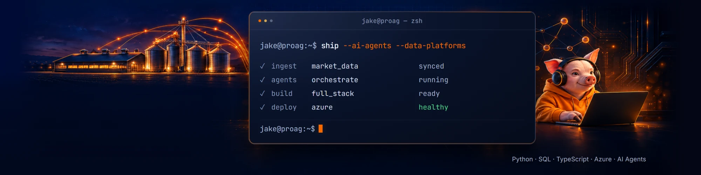

<p align="center">
  <a href="https://github.com/Tersch23">
    
  </a>
</p>

<p align="center">
  <a href="https://www.linkedin.com/in/jacobvontersch"></a>
  <a href="https://tersch23.github.io/NFL-Leverage-Report/"></a>
  
</p>

```python
class Jake(Engineer):
    role       = "Tech Lead @ Professional Ag Marketing"
    builds     = ["AI agents", "data platforms", "full-stack apps"]
    for_who    = "hog, cattle and grain producers"
    pairs_with = ["Claude Code", "OpenAI Codex", "Grok"]
    speaks     = ["Python", "SQL", "TypeScript", "JavaScript", "R", "Pig Latin"]
    alma_mater = "Syracuse University, B.S. Applied Data Science '26"
    previously = "ACHA D1 hockey, Syracuse"

    def philosophy(self):
        return "Agents write the code. Guardrails make it trustworthy."
```

## Toolbox

<p>
  
  
  
  
</p>

<p>
  
</p>

<p>
  
  
  
  
  
</p>

## Side quests

- **Sports models.** Predictive models and analysis for MLB, the NFL and NCAA hoops. The public ones are below.
- **Money OS.** My personal finance operating system: a local command center, automated data ingest, and AI agents that research decisions and log why I made them.
- **Personal OS.** The agent setup I'm building to run my own day-to-day.

## Public work

| Project | What it does | Built with |
|---|---|---|
| [NFL Leverage Report](https://github.com/Tersch23/NFL-Leverage-Report) | Ranks a team's biggest improvement opportunities by situational EPA. [Live report](https://tersch23.github.io/NFL-Leverage-Report/) | Python, nflverse, Matplotlib |
| [MLB WAR-162 Forecast](https://github.com/Tersch23/mlb-war162-forecast) | Next-season player value from prior-season data, with leakage controls | PySpark, MLlib |
| [NCAA Hoops Dashboard](https://github.com/Tersch23/NCAA-Basketball-Dashboard) | Shot charts, team comparisons and standings across four conferences | Python, Streamlit, Plotly |
| [Orange Hoops Challenge](https://github.com/Tersch23/Orange_Hoops_Challenge) | Who should take the last shot? A clutch-shot model | Python, scikit-learn, R |
| [2025 Playoffs Statcast](https://github.com/Tersch23/mlb-2025-playoffs-statcast) | What separates elite postseason hitters | R, ggplot2 |
| [Ag Market Predictor](https://github.com/Tersch23/ag-market-predictor) | Commodity price-direction model with offline local-LLM briefings | Python, XGBoost, llama.cpp |

Most of what I build day to day is private. This is the part I can show.

## Activity

<p align="center">
  
</p>

```text
     ^..^      // senior engineer
    ( oo )~    // reviews every PR, oinks at flaky tests
```
